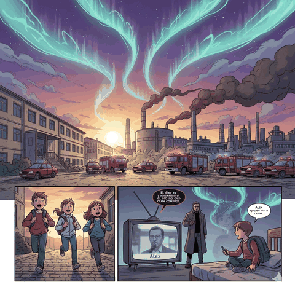

License: Creative Commons Attribution-NonCommercial 4.0 International (CC BY-NC 4.0)
# ENTRE BARCOS Y ACERO // SESTAO 1992
### *El Laboratorio Secreto de Babcock & Wilcox*

> **Manual de aventura y guía de ambientación para el juego de rol Kids on Bikes**  
> **Sistema Kids on Bikes** (investigación juvenil, bicicletas y misterios sobrenaturales)  
> **Autor:** Samtzai | **Ambientación:** Sestao, Margen Izquierda de Bizkaia (Otoño de 1992)

---

## ⚡ Acceso Rápido y Recursos de la Campaña

Haz clic en las previsualizaciones para abrir y descargar los manuales completos y las fichas de juego en GitHub:

| 📖 Manual de Aventura (PDF) | 🎬 Prólogo Cinemático (Teaser) | 📋 Ficha de Jugador (PDF) | ⚡ Ficha de Alex Potenciado (PDF) |
| :---: | :---: | :---: | :---: |
| [](main.pdf) | [](video_prompt.txt) | [](ficha_personaje.pdf) | [](ficha_alex_potenciado.pdf) |
| [📖 **Abrir Manual Completo (43 págs, A5)**](main.pdf) | [🎬 **Ver Guion del Tráiler (video_prompt.txt)**](video_prompt.txt) | [📋 **Abrir Ficha de Personaje (A4)**](ficha_personaje.pdf) | [⚡ **Abrir Ficha de Alex (A4)**](ficha_alex_potenciado.pdf) |

---

## 🎬 Prólogo Audiovisual: *Entre Barcos y Acero*

La aventura cuenta con un guion cinemático inmersivo diseñado como prólogo para ser narrado o reproducido antes de comenzar la partida:

<p align="center">
  
  <br>
  <em>Teaser cinemático de la aventura: de los recreativos al laboratorio secreto</em>
</p>

* **Ambientación:** Sestao, ría del Nervión, recreativos de Txetxu, otoño de 1992.
* **Guion técnico detallado:** [video_prompt.txt](video_prompt.txt) (diseñado para herramientas generativas de vídeo y lectura en mesa).

### Estructura de las escenas del prólogo:
1. **La Ría de Óxido (0:00 - 0:20):** La ría del Nervión al atardecer bajo el sirimiri; chimeneas de Altos Hornos de Vizcaya y cuadrilla en bicicletas BH y Orbea.
2. **Los Recreativos y el Cartel (0:20 - 0:40):** La Gran Vía, la sala de juegos de Txetxu (*Street Fighter II*, futbolines) y el cartel desgastado de búsqueda de Alex Etxebarria.
3. **La Explosión en B&W (0:40 - 0:55):** Detonación esmeralda en los laboratorios de Babcock & Wilcox; bomberos y coches patrulla cruzando las vallas.
4. **El Encuentro en la Penumbra (0:55 - 1:10):** En una caseta de huerta, Alex Etxebarria reaparece empapado con los ojos brillando en luz alienígena mientras las herramientas levitan.
5. **El Eclipse Lunar (1:10 - 1:20):** La luna se tiñe de rojo sobre las minas de La Arboleda en la noche del 8 de diciembre de 1992.

---

## 🚲 La Ambientación: Sestao, 1992

<p align="center">
  
  &nbsp;
  
  <br>
  <em>Izquierda: Tarde de otoño en el parque de Markonzaga. Derecha: Emergencia en Babcock & Wilcox.</em>
</p>

Mientras España celebra el año triunfal de las Olimpiadas de Barcelona y la Expo de Sevilla, en la margen izquierda de Bizkaia la realidad es de reconversión industrial, huelgas obreras y chimeneas decadentes:

* **Altos Hornos de Vizcaya (AHV):** El gigante siderúrgico agonizante junto a la ría y La Benedicta.
* **Babcock & Wilcox (B&W):** La multinacional en la vega de Galindo que fabricó componentes de reactores nucleares en los 80 y oculta un búnker de experimentación energética.
* **La Sociedad de Ciencias Naturales:** Custodia de fósiles y mapas de cuevas mineras, dirigida por el paleontólogo Francisco.
* **Los Montes de La Arboleda y el Funicular de La Reineta:** Pozos mineros, lagos artificiales y galerías donde duerme una antigua colonia fósil de amonites cósmicos.
* **La Sala de Juegos de Txetxu:** Epicentro de reunión juvenil en la Gran Vía entre partidas de 25 pesetas y bocadillos.

---

## 🎲 Sistema de Juego: Kids on Bikes

El juego utiliza el motor narrativo de **Kids on Bikes** basado en dados poliédricos según el talento del personaje:

### 1. Los Seis Atributos
Cada personaje reparte los dados **(d20, d12, d10, d8, d6, d4)** entre:
* **Astucia (Brains):** Lógica, libros, electrónica y deducción.
* **Músculo (Brawn):** Fuerza física, forzar cerraduras o empujar maquinaria.
* **Combate (Fight):** Pelear cuerpo a cuerpo o proteger a un amigo con tirachinas.
* **Reflejos (Flight):** Pedalear a toda prisa, saltar bordillos y esquivar peligros.
* **Vigor (Grit):** Sangre fría, agallas para no entrar en pánico y resistencia.
* **Labia (Charm):** Carisma, convencer a los adultos y calmar tensiones.

### 2. Dados Explosivos y Fichas de Adversidad
* **Dados explosivos:** Si sacas el resultado máximo de tu dado (ej. un 8 en 1d8), ¡el dado explota y vuelves a tirar sumando el valor!
* **Fichas de Adversidad:** Cada tirada fallida otorga 1 Ficha de Adversidad. Se pueden gastar para sumar +1 a futuras acciones o para activar los poderes del Personaje Potenciado.

---

## ⚡ El Personaje Potenciado: Alex Etxebarria

Alex es un niño de 11 años que desapareció en 1989 y ha desarrollado poderes psíquicos por su contacto con el Éter. Su control es compartido entre todos los jugadores:

<p align="center">
  
  &nbsp;
  
  <br>
  <em>Izquierda: Reaparición de Alex en la noche. Derecha: Emboscada de Kessler en el parque.</em>
</p>

* **Aspectos compartidos:** Los jugadores se reparten los 4 aspectos de Alex (Guardián de los Recuerdos, Brújula Emocional, Canalizador del Éter y Protector del Grupo).
* **Poderes:** Telequinesis menor (1 ficha), Visión de energía (1 ficha), Escudo de resonancia (2 fichas), Distorsión temporal (3 fichas).
* **Tiradas de estrés:** Riesgo de fugas de energía electromagnética o sobrecargas cósmicas.

---

## 👥 Arquetipos de la Cuadrilla

1. **El Friki de los Recreativos:** Experto en atajos, videojuegos de Txetxu y bicicleta Orbea BMX.
2. **La Ciclista de «Azkarrak»:** Estrella deportiva del polideportivo municipal y bicicleta BH California.
3. **El Empollón de la Sociedad de Ciencias:** Discípulo de Francisco con linterna de petaca y mapa de minas.
4. **El Hijo de Obrero de AHV:** Rudo, cazadora vaquera, tirachinas casero y lealtad inquebrantable.
5. **La Pija Rebelde de Las Llanas:** Hija de directivo de B&W con cámara compacta, walkie-talkie y llaves maestras.

---

## 🗺️ La Aventura en 8 Escenas

<p align="center">
  
  &nbsp;
  
  <br>
  <em>Izquierda: La nave alienígena en La Arboleda. Derecha: Clímax final durante el eclipse.</em>
</p>

1. **Escena 1: El incendio en Babcock & Wilcox** — Sobrecarga en la vega de Galindo y la huida de Alex.
2. **Escena 2: El escondite secreto (La huerta)** — Reunión nocturna, teorías y el especial de Paco Lobatón.
3. **Escena 3: Primera incursión en La Arboleda** — Viaje en funicular, bocamina cercada y huellas recientes.
4. **Escena 4: La Sociedad de Ciencias Naturales** — Encuentro con Francisco, amonites cósmicos y la advertencia del eclipse.
5. **Escena 5: La reaparición de Alex** — Alex llega a la huerta empapado; asignación de la ficha de Personaje Potenciado.
6. **Escena 6: Emboscada en el parque de Markonzaga** — Kessler y sus guardias intentan secuestrar a Alex; persecución en bicicletas.
7. **Escena 7: El santuario de La Arboleda** — Descubrimiento de la nave alienígena y el glifo de resonancia armónica.
8. **Escena 8: El clímax final en B&W (Noche del 8 de diciembre)** — Infiltración en el búnker durante el eclipse lunar, neutralización del reactor y rescate definitivo de Alex.

---

## 🛠️ Compilación del Proyecto

El proyecto está maquetado en **XeLaTeX** con tipografías TeX Gyre y compilación automatizada:

```bash
# Instalar dependencias necesarias en Ubuntu/Debian:
sudo apt-get install -y texlive-xetex texlive-latex-extra texlive-fonts-recommended texlive-lang-spanish latexmk

# Compilar todos los documentos:
make

# Limpiar archivos auxiliares de compilación:
make clean
```

### Archivos compilados resultantes:
* `main.pdf` — Manual completo de aventura y ambientación (43 páginas, tamaño A5).
* `ficha_personaje.pdf` — Ficha de jugador Kids on Bikes (1 página, tamaño A4).
* `ficha_alex_potenciado.pdf` — Ficha de Personaje Potenciado para Alex (1 página, tamaño A4).

---

## 📁 Estructura del Repositorio

```text
kob_sestao/
├── main.pdf                          # Manual completo de aventura (43 págs, A5)
├── ficha_personaje.pdf               # Ficha de personaje Kids on Bikes (A4)
├── ficha_alex_potenciado.pdf         # Ficha de Personaje Potenciado para Alex (A4)
├── main.tex                          # Archivo maestro LaTeX del libro
├── ficha_personaje.tex               # Código fuente LaTeX de la ficha de jugador
├── ficha_alex_potenciado.tex         # Código fuente LaTeX de la ficha de Alex
├── kob_sestao.sty                    # Paquete de estilos, fuentes y cajas
├── Makefile                          # Automatización de compilación con XeLaTeX
├── video_prompt.txt                  # Guion cinemático completo para el tráiler
│
├── chapters/                         # Capítulos modulares del libro
│   ├── 00_portada.tex                # Portada institucional
│   ├── 01_introduccion.tex           # Introducción para jugadores y prólogo cinemático
│   ├── 02_secreto_director.tex       # Secretos del Éter y el plan de Kessler
│   ├── 03_sestao_1992.tex            # Geografía y lugares emblemáticos de Sestao
│   ├── 04_sociedades_facciones.tex   # Facciones, tabla de rumores y PNJs
│   ├── 05_motor_kob.tex              # Reglas adaptadas de Kids on Bikes
│   ├── 06_personaje_potenciado.tex   # Reglas para el Personaje Potenciado
│   ├── 07_arquetipos.tex             # Arquetipos pregenerados para la cuadrilla
│   ├── 08_guia_director.tex          # Guía del DJ y reloj de tensión del eclipse
│   └── 09_campana_escenas.tex        # Desarrollo paso a paso de las 8 escenas
│
└── images/                           # Ilustraciones y previsualizaciones
    ├── 2.1 Boy_looking_at_river_glow_20261013235457.jpg    # Portada (chico mirando el río)
    ├── 2.2 Teenage_boy_riding_BMX_bike_20261013235341.jpg  # Adolescente en bicicleta BMX
    ├── 2.3 Scientist_examining_glowing_alie…_20261013235344.jpg  # Fig. 4.1 Francisco/Sociedad Ciencias
    ├── 2.4 Comic_book_collage_illustration_…_20261013235409.jpg  # Collage cómic
    ├── 2.5.1 Children_riding_bikes_near_factory_20261013235326.jpg  # Fig. 1.1 Parque Markonzaga
    ├── 2.5.2 Abandoned_wooden_shed_with_lantern_20261013235311.jpg  # Fig. 3.1 El escondite (huerta)
    ├── 2.5.3 Boy_confronted_by_dogs_and_20261013235337.jpg  # Chico acorralado por perros
    ├── 2.5.4 Teenage_boy_floating_in_cave_20261013235333.jpg # Chico flotando en cueva
    ├── 01_parque_markonzaga.jpg        # Fig. 9.1 Parque Markonzaga (escena 1 campaña)
    ├── 03_sociedad_ciencias.jpg        # Fig. 9.2 Francisco en la Sociedad de Ciencias (escena 4)
    ├── 04_aparicion_alex.jpg           # Alex Etxebarria (cap. 6 y escena 5)
    ├── 05_emboscada_parque.jpg         # Emboscada de Kessler (escena 6)
    ├── 06_cueva_arboleda.jpg           # Nave alienígena en La Arboleda (escena 7)
    ├── 07_laboratorio_final.jpg        # Clímax final en B&W (escena 8)
    ├── 08_backcover.jpg                # Contraportada
    └── trailer.mp4                     # Vídeo tráiler de la aventura
```

---

## ✒️ Créditos

* **Autor:** Samtzai
* **Juego base:** Kids on Bikes (Hunters Entertainment)
* **Ambientación e ilustraciones:** Sestao, Margen Izquierda (1992)
